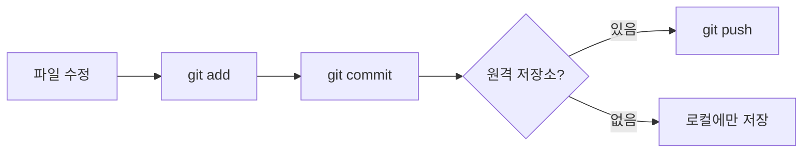
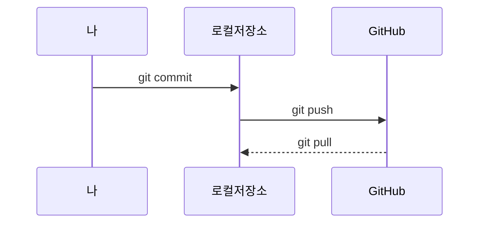
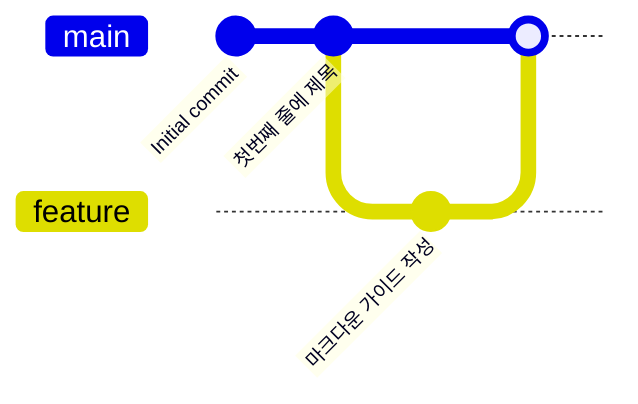

# gitexcercise
gitexcercise sample

---

# 📘 마크다운(Markdown) 문법 완벽 가이드

> 이 문서는 **마크다운 문법 자체를 마크다운으로 작성한** 레퍼런스입니다.
> 각 항목마다 **① 작성 방법(원본 코드)** 과 **② 실제 표시 결과** 를 함께 보여줍니다.
> GitHub에서 사용하는 **GFM(GitHub Flavored Markdown)** 기준으로 설명합니다.

## 📑 목차

1. [마크다운이란?](#1-마크다운이란)
2. [제목 (Headings)](#2-제목-headings)
3. [문단과 줄바꿈](#3-문단과-줄바꿈)
4. [텍스트 강조](#4-텍스트-강조)
5. [인용문 (Blockquote)](#5-인용문-blockquote)
6. [목록 (Lists)](#6-목록-lists)
7. [체크리스트 (Task List)](#7-체크리스트-task-list)
8. [코드 (Code)](#8-코드-code)
9. [수평선 (Horizontal Rule)](#9-수평선-horizontal-rule)
10. [링크 (Links)](#10-링크-links)
11. [이미지 (Images)](#11-이미지-images)
12. [표 (Tables)](#12-표-tables)
13. [이스케이프 문자](#13-이스케이프-문자)
14. [각주 (Footnotes)](#14-각주-footnotes)
15. [HTML 태그 사용](#15-html-태그-사용)
16. [접기/펼치기 (Details)](#16-접기펼치기-details)
17. [이모지 (Emoji)](#17-이모지-emoji)
18. [GitHub 알림 박스 (Alerts)](#18-github-알림-박스-alerts)
19. [수식 (Math)](#19-수식-math)
20. [다이어그램 (Mermaid)](#20-다이어그램-mermaid)
21. [GitHub 전용 자동 링크](#21-github-전용-자동-링크)
22. [주석 (Comments)](#22-주석-comments)
23. [자주 하는 실수](#23-자주-하는-실수)
24. [한눈에 보는 치트시트](#24-한눈에-보는-치트시트)

---

## 1. 마크다운이란?

**마크다운(Markdown)** 은 2004년 존 그루버(John Gruber)가 만든 **경량 마크업 언어**입니다.
일반 텍스트에 간단한 기호(`#`, `*`, `-` 등)를 붙여서 서식을 지정하며, HTML로 변환되어 보기 좋게 표시됩니다.

**장점**

- 문법이 단순해서 배우기 쉽다
- 원본 텍스트 자체도 읽기 편하다
- GitHub, Notion, Slack, 블로그 등 거의 모든 곳에서 지원한다
- `.md` 파일 하나로 문서화가 가능하다 (예: 이 `README.md`)

---

## 2. 제목 (Headings)

`#` 기호의 개수로 제목의 단계(1~6)를 지정합니다. **`#` 뒤에는 반드시 공백**을 넣어야 합니다.

**작성 방법**

```markdown
# 제목 1 (H1)
## 제목 2 (H2)
### 제목 3 (H3)
#### 제목 4 (H4)
##### 제목 5 (H5)
###### 제목 6 (H6)
```

**표시 결과**

# 제목 1 (H1)
## 제목 2 (H2)
### 제목 3 (H3)
#### 제목 4 (H4)
##### 제목 5 (H5)
###### 제목 6 (H6)

### 대체 문법 (Setext 방식)

H1과 H2는 텍스트 아래에 `=` 또는 `-`를 이어서 쓰는 방식으로도 만들 수 있습니다.

```markdown
제목 1
======

제목 2
------
```

> 💡 **팁:** 문서에는 `#`(H1)을 한 번만 쓰고, 나머지는 `##`부터 계층적으로 쓰는 것이 좋습니다.

---

## 3. 문단과 줄바꿈

### 문단

빈 줄 하나로 문단을 구분합니다.

```markdown
첫 번째 문단입니다.

두 번째 문단입니다.
```

### 줄바꿈

마크다운에서는 **그냥 엔터를 한 번 치면 줄바꿈이 되지 않습니다.** (같은 문단으로 이어짐)
줄바꿈을 하려면 다음 중 하나를 사용합니다.

| 방법 | 작성 예 | 설명 |
|------|---------|------|
| 공백 2칸 | `첫 줄␣␣` + 엔터 | 줄 끝에 스페이스 2개 |
| 백슬래시 | `첫 줄\` + 엔터 | 줄 끝에 `\` |
| HTML 태그 | `첫 줄<br>둘째 줄` | `<br>` 태그 사용 |

**표시 결과**

공백 2칸을 이용한 줄바꿈입니다.  
다음 줄로 넘어갔습니다.

백슬래시를 이용한 줄바꿈입니다.\
다음 줄로 넘어갔습니다.

br 태그를 이용한 줄바꿈입니다.<br>다음 줄로 넘어갔습니다.

---

## 4. 텍스트 강조

**작성 방법**

```markdown
*기울임꼴* 또는 _기울임꼴_
**굵게** 또는 __굵게__
***굵게 + 기울임*** 또는 ___굵게 + 기울임___
~~취소선~~
<u>밑줄</u>
<mark>형광펜</mark>
H<sub>2</sub>O (아래 첨자)
x<sup>2</sup> (위 첨자)
<kbd>Ctrl</kbd> + <kbd>C</kbd> (키보드 키)
```

**표시 결과**

- *기울임꼴* 또는 _기울임꼴_
- **굵게** 또는 __굵게__
- ***굵게 + 기울임*** 또는 ___굵게 + 기울임___
- ~~취소선~~
- <u>밑줄</u>
- <mark>형광펜</mark>
- H<sub>2</sub>O (아래 첨자)
- x<sup>2</sup> (위 첨자)
- <kbd>Ctrl</kbd> + <kbd>C</kbd> (키보드 키)

### 중첩 강조

```markdown
**굵은 글씨 안에 _기울임_ 을 넣을 수 있습니다.**
~~취소선 안에 **굵게** 도 가능합니다.~~
```

**굵은 글씨 안에 _기울임_ 을 넣을 수 있습니다.**
~~취소선 안에 **굵게** 도 가능합니다.~~

> ⚠️ **주의:** 한글 단어 중간에 `*`를 쓸 때는 `_`보다 `*`가 더 안정적으로 동작합니다.
> 예) `마크**다운**문법` → 마크**다운**문법

---

## 5. 인용문 (Blockquote)

줄 앞에 `>` 를 붙입니다.

**작성 방법**

```markdown
> 이것은 인용문입니다.
> 여러 줄을 이어서 쓸 수 있습니다.
>
> > 중첩된 인용문입니다.
> > > 3단계 중첩도 가능합니다.
>
> 인용문 안에서도 **굵게**, `코드`, [링크](https://github.com) 등을 쓸 수 있습니다.
> - 목록도
> - 가능합니다
```

**표시 결과**

> 이것은 인용문입니다.
> 여러 줄을 이어서 쓸 수 있습니다.
>
> > 중첩된 인용문입니다.
> > > 3단계 중첩도 가능합니다.
>
> 인용문 안에서도 **굵게**, `코드`, [링크](https://github.com) 등을 쓸 수 있습니다.
> - 목록도
> - 가능합니다

---

## 6. 목록 (Lists)

### 6-1. 순서 없는 목록 (Unordered List)

`-`, `*`, `+` 중 하나를 사용합니다. 들여쓰기(공백 2~4칸)로 하위 목록을 만듭니다.

**작성 방법**

```markdown
- 과일
  - 사과
  - 바나나
    - 노란 바나나
    - 초록 바나나
* 채소
  * 당근
+ 곡물
  + 쌀
```

**표시 결과**

- 과일
  - 사과
  - 바나나
    - 노란 바나나
    - 초록 바나나
* 채소
  * 당근
+ 곡물
  + 쌀

### 6-2. 순서 있는 목록 (Ordered List)

숫자 뒤에 `.`을 붙입니다. **숫자는 자동으로 매겨지므로** 모두 `1.`로 써도 됩니다.

**작성 방법**

```markdown
1. 첫 번째
2. 두 번째
   1. 두 번째의 하위 1
   2. 두 번째의 하위 2
3. 세 번째

1. 모두 1로 써도
1. 자동으로
1. 번호가 매겨집니다

5. 시작 번호를
6. 지정할 수도 있습니다
```

**표시 결과**

1. 첫 번째
2. 두 번째
   1. 두 번째의 하위 1
   2. 두 번째의 하위 2
3. 세 번째

<!-- 목록 분리용 -->

1. 모두 1로 써도
1. 자동으로
1. 번호가 매겨집니다

<!-- 목록 분리용 -->

5. 시작 번호를
6. 지정할 수도 있습니다

### 6-3. 혼합 목록 및 목록 안의 내용

목록 항목 안에 문단, 코드 블록, 인용문을 넣으려면 **항목 텍스트의 시작 위치에 맞춰 들여쓰기**합니다.

````markdown
1. 설치하기
   - Windows
   - macOS

   설치 후 아래 명령을 실행합니다.

   ```bash
   git --version
   ```

2. 설정하기
   > 사용자 이름과 이메일을 설정하세요.
````

**표시 결과**

1. 설치하기
   - Windows
   - macOS

   설치 후 아래 명령을 실행합니다.

   ```bash
   git --version
   ```

2. 설정하기
   > 사용자 이름과 이메일을 설정하세요.

---

## 7. 체크리스트 (Task List)

`- [ ]` 는 미완료, `- [x]` 는 완료를 의미합니다. *(GFM 확장 문법)*

**작성 방법**

```markdown
- [x] Git 설치하기
- [x] 저장소 만들기
- [ ] 커밋하기
  - [x] 파일 수정
  - [ ] git add
  - [ ] git commit
- [ ] 푸시하기
```

**표시 결과**

- [x] Git 설치하기
- [x] 저장소 만들기
- [ ] 커밋하기
  - [x] 파일 수정
  - [ ] git add
  - [ ] git commit
- [ ] 푸시하기

---

## 8. 코드 (Code)

### 8-1. 인라인 코드

백틱(`` ` ``) 한 개로 감쌉니다.

```markdown
터미널에서 `git status` 명령을 실행하세요.
```

터미널에서 `git status` 명령을 실행하세요.

코드 안에 백틱 자체를 넣고 싶다면 **백틱 2개**로 감쌉니다.

```markdown
`` `백틱`이 포함된 코드 ``
```

`` `백틱`이 포함된 코드 ``

### 8-2. 코드 블록 (Fenced Code Block)

백틱 3개(` ``` `) 또는 물결표 3개(`~~~`)로 감싸고, 시작 부분에 **언어 이름**을 쓰면 문법 강조(Syntax Highlighting)가 적용됩니다.

**작성 방법**

````markdown
```python
def hello(name):
    print(f"안녕하세요, {name}님!")

hello("민형")
```
````

**표시 결과**

```python
def hello(name):
    print(f"안녕하세요, {name}님!")

hello("민형")
```

### 8-3. 다양한 언어 예시

```javascript
// JavaScript
const greet = (name) => console.log(`Hello, ${name}!`);
greet("World");
```

```java
// Java
public class Main {
    public static void main(String[] args) {
        System.out.println("Hello, World!");
    }
}
```

```bash
# Bash
git add .
git commit -m "첫 커밋"
git push origin main
```

```json
{
  "name": "gitexcercise",
  "version": "1.0.0",
  "private": true
}
```

```html
<!-- HTML -->
<h1>안녕하세요</h1>
<p>마크다운 연습 중입니다.</p>
```

```css
/* CSS */
body {
  font-family: sans-serif;
  color: #333;
}
```

```sql
-- SQL
SELECT name, email FROM users WHERE active = 1;
```

### 8-4. diff 강조

변경 사항을 보여줄 때 `diff`를 쓰면 추가(`+`)는 초록색, 삭제(`-`)는 빨간색으로 표시됩니다.

````markdown
```diff
- const old = "이전 코드";
+ const now = "새로운 코드";
  const same = "변경 없음";
```
````

```diff
- const old = "이전 코드";
+ const now = "새로운 코드";
  const same = "변경 없음";
```

### 8-5. 들여쓰기 코드 블록

줄 앞에 **공백 4칸(또는 탭)** 을 넣어도 코드 블록이 됩니다. (언어 지정 불가)

    이것은 들여쓰기로 만든
    코드 블록입니다.

### 8-6. 코드 블록 안에 코드 블록 넣기

바깥쪽 펜스를 **백틱 4개**(` ```` `)로 만들면 안쪽에 백틱 3개를 그대로 보여줄 수 있습니다.

`````markdown
````markdown
```python
print("hello")
```
````
`````

---

## 9. 수평선 (Horizontal Rule)

`-`, `*`, `_` 중 하나를 **3개 이상** 연속으로 씁니다.

```markdown
---
***
___
```

**표시 결과**

---

***

___

> ⚠️ **주의:** 텍스트 바로 아래 줄에 `---`를 쓰면 수평선이 아니라 **H2 제목**(Setext)이 됩니다. 반드시 위에 빈 줄을 두세요.

---

## 10. 링크 (Links)

### 10-1. 인라인 링크

```markdown
[GitHub](https://github.com)
[마우스를 올려보세요](https://github.com "GitHub 홈페이지로 이동")
```

[GitHub](https://github.com)
[마우스를 올려보세요](https://github.com "GitHub 홈페이지로 이동")

### 10-2. 자동 링크

```markdown
<https://www.google.com>
<ranma0831@gmail.com>
https://www.google.com (GFM에서는 URL만 써도 자동 링크)
```

<https://www.google.com>
<ranma0831@gmail.com>
https://www.google.com

### 10-3. 참조 링크 (Reference-style)

긴 URL을 문서 아래쪽에 모아두고 이름으로 참조합니다.

```markdown
[구글][google]과 [네이버][naver]를 자주 사용합니다.
[GitHub 문서][1]도 참고하세요.

[google]: https://www.google.com
[naver]: https://www.naver.com
[1]: https://docs.github.com "GitHub Docs"
```

[구글][google]과 [네이버][naver]를 자주 사용합니다.
[GitHub 문서][1]도 참고하세요.

[google]: https://www.google.com
[naver]: https://www.naver.com
[1]: https://docs.github.com "GitHub Docs"

### 10-4. 문서 내부 링크 (앵커)

제목은 자동으로 앵커가 생성됩니다. 규칙은 **소문자로 변환, 공백은 `-`로, 특수문자는 제거**입니다.

```markdown
[목차로 이동](#-목차)
[코드 섹션으로 이동](#8-코드-code)
```

[목차로 이동](#-목차)
[코드 섹션으로 이동](#8-코드-code)

### 10-5. 상대 경로 링크

같은 저장소 안의 다른 파일로 연결할 수 있습니다.

```markdown
[README 파일](./README.md)
[docs 폴더의 가이드](docs/guide.md)
```

---

## 11. 이미지 (Images)

링크 문법 앞에 `!`를 붙입니다.

**작성 방법**

```markdown


```

**표시 결과**


### 11-1. 이미지 크기 조절

마크다운 자체에는 크기 조절 문법이 없으므로 **HTML `` 태그**를 사용합니다.

```html

```


### 11-2. 이미지에 링크 걸기

이미지 문법을 링크 문법으로 감쌉니다.

```markdown
[](https://github.com)
```

### 11-3. 이미지 가운데 정렬

```html
<p align="center">
  
</p>
```

<p align="center">
  
</p>

### 11-4. 배지 (Badges)

README에 자주 쓰는 배지는 [shields.io](https://shields.io)에서 만들 수 있습니다.

```markdown


```


---

## 12. 표 (Tables)

`|`로 열을 나누고, 두 번째 줄에 `---`로 헤더를 구분합니다. *(GFM 확장 문법)*

### 12-1. 기본 표

```markdown
| 이름 | 나이 | 직업 |
|------|------|------|
| 철수 | 25 | 개발자 |
| 영희 | 30 | 디자이너 |
```

| 이름 | 나이 | 직업 |
|------|------|------|
| 철수 | 25 | 개발자 |
| 영희 | 30 | 디자이너 |

### 12-2. 정렬

구분선에 `:`를 붙여 정렬을 지정합니다.

| 문법 | 정렬 |
|------|------|
| `:---` | 왼쪽 정렬 |
| `:---:` | 가운데 정렬 |
| `---:` | 오른쪽 정렬 |

```markdown
| 왼쪽 정렬 | 가운데 정렬 | 오른쪽 정렬 |
|:----------|:-----------:|------------:|
| 사과 | 1,000원 | 10개 |
| 바나나 | 2,500원 | 5개 |
| 수박 | 15,000원 | 1개 |
```

| 왼쪽 정렬 | 가운데 정렬 | 오른쪽 정렬 |
|:----------|:-----------:|------------:|
| 사과 | 1,000원 | 10개 |
| 바나나 | 2,500원 | 5개 |
| 수박 | 15,000원 | 1개 |

### 12-3. 표 안에서 서식 사용

```markdown
| 명령어 | 설명 | 중요도 |
|--------|------|:------:|
| `git init` | 저장소 **초기화** | ⭐⭐⭐ |
| `git add` | 변경사항 *스테이징* | ⭐⭐⭐ |
| `git commit` | [커밋](https://git-scm.com) 생성 | ⭐⭐⭐ |
| `git push` | 원격에 업로드<br>(줄바꿈은 `<br>`) | ⭐⭐ |
| `a \| b` | 파이프 문자는 `\|`로 이스케이프 | ⭐ |
```

| 명령어 | 설명 | 중요도 |
|--------|------|:------:|
| `git init` | 저장소 **초기화** | ⭐⭐⭐ |
| `git add` | 변경사항 *스테이징* | ⭐⭐⭐ |
| `git commit` | [커밋](https://git-scm.com) 생성 | ⭐⭐⭐ |
| `git push` | 원격에 업로드<br>(줄바꿈은 `<br>`) | ⭐⭐ |
| `a \| b` | 파이프 문자는 `\|`로 이스케이프 | ⭐ |

> 💡 **팁:** 열 너비를 맞추지 않아도 정상적으로 표시됩니다. 원본 가독성을 위해 맞추는 것뿐입니다.

---

## 13. 이스케이프 문자

마크다운 기호를 **문자 그대로** 표시하려면 앞에 백슬래시(`\`)를 붙입니다.

```markdown
\*별표가 기울임꼴이 되지 않습니다\*
\# 제목이 되지 않습니다
\[대괄호\]
1\. 목록이 되지 않습니다
```

\*별표가 기울임꼴이 되지 않습니다\*
\# 제목이 되지 않습니다
\[대괄호\]
1\. 목록이 되지 않습니다

**이스케이프 가능한 문자 목록**

| 문자 | 이름 | 문자 | 이름 |
|:----:|------|:----:|------|
| `\` | 백슬래시 | `#` | 샵 |
| `` ` `` | 백틱 | `+` | 더하기 |
| `*` | 별표 | `-` | 빼기 |
| `_` | 밑줄 | `.` | 마침표 |
| `{ }` | 중괄호 | `!` | 느낌표 |
| `[ ]` | 대괄호 | `\|` | 파이프 |
| `( )` | 소괄호 | `< >` | 꺾쇠 |

**HTML 엔티티**도 사용할 수 있습니다: `&lt;` → &lt;, `&gt;` → &gt;, `&amp;` → &amp;, `&copy;` → &copy;, `&nbsp;`(공백)

---

## 14. 각주 (Footnotes)

본문에 `[^이름]`을 쓰고, 문서 어딘가에 `[^이름]: 내용`을 작성합니다. 각주는 문서 맨 아래에 모여서 표시됩니다.

```markdown
마크다운은 존 그루버가 만들었습니다.[^1]
GFM은 GitHub의 확장 문법입니다.[^gfm]

[^1]: 2004년, 아론 스워츠와 함께 만들었습니다.
[^gfm]: GitHub Flavored Markdown의 약자입니다.
```

마크다운은 존 그루버가 만들었습니다.[^1]
GFM은 GitHub의 확장 문법입니다.[^gfm]

[^1]: 2004년, 아론 스워츠와 함께 만들었습니다.
[^gfm]: GitHub Flavored Markdown의 약자입니다.

---

## 15. HTML 태그 사용

마크다운 안에서 대부분의 HTML 태그를 직접 사용할 수 있습니다. (단, GitHub에서는 보안상 `<script>`, `<style>`, `style` 속성 등은 제거됩니다.)

```html
<h3 align="center">가운데 정렬된 제목</h3>

<p align="right">오른쪽 정렬된 문단</p>

<dl>
  <dt>용어</dt>
  <dd>용어에 대한 정의입니다.</dd>
</dl>

<abbr title="HyperText Markup Language">HTML</abbr>에 마우스를 올려보세요.
```

<h3 align="center">가운데 정렬된 제목</h3>

<p align="right">오른쪽 정렬된 문단</p>

<dl>
  <dt>용어</dt>
  <dd>용어에 대한 정의입니다.</dd>
</dl>

<abbr title="HyperText Markup Language">HTML</abbr>에 마우스를 올려보세요.

> 💡 **팁:** HTML 블록 안에서 마크다운 문법을 쓰려면 HTML 태그와 마크다운 사이에 **빈 줄**을 넣어야 합니다.

---

## 16. 접기/펼치기 (Details)

`<details>`와 `<summary>` 태그로 내용을 숨겼다가 클릭하면 펼칠 수 있습니다.

````html
<details>
<summary>👉 클릭해서 펼치기</summary>

숨겨진 내용입니다. **마크다운**도 사용할 수 있습니다.

```bash
git log --oneline
```

</details>

<details open>
<summary>기본으로 펼쳐진 상태</summary>

`open` 속성을 주면 처음부터 열려 있습니다.

</details>
````

<details>
<summary>👉 클릭해서 펼치기</summary>

숨겨진 내용입니다. **마크다운**도 사용할 수 있습니다.

```bash
git log --oneline
```

</details>

<details open>
<summary>기본으로 펼쳐진 상태</summary>

`open` 속성을 주면 처음부터 열려 있습니다.

</details>

---

## 17. 이모지 (Emoji)

GitHub에서는 `:이모지이름:` 형식의 **숏코드**를 사용할 수 있습니다. 유니코드 이모지를 직접 붙여 넣어도 됩니다.

```markdown
:smile: :heart: :thumbsup: :rocket: :fire: :star: :tada: :warning: :memo: :bug:
```

:smile: :heart: :thumbsup: :rocket: :fire: :star: :tada: :warning: :memo: :bug:

| 숏코드 | 결과 | 숏코드 | 결과 |
|--------|:----:|--------|:----:|
| `:smile:` | :smile: | `:rocket:` | :rocket: |
| `:+1:` | :+1: | `:white_check_mark:` | :white_check_mark: |
| `:x:` | :x: | `:bulb:` | :bulb: |
| `:books:` | :books: | `:sparkles:` | :sparkles: |

> 📎 전체 목록: [Emoji Cheat Sheet](https://github.com/ikatyang/emoji-cheat-sheet)

---

## 18. GitHub 알림 박스 (Alerts)

인용문 첫 줄에 `[!종류]`를 쓰면 GitHub에서 색상이 있는 알림 박스로 표시됩니다.

```markdown
> [!NOTE]
> 참고할 만한 유용한 정보입니다.

> [!TIP]
> 더 잘 사용하기 위한 팁입니다.

> [!IMPORTANT]
> 반드시 알아야 할 중요한 정보입니다.

> [!WARNING]
> 문제가 생길 수 있으니 주의가 필요합니다.

> [!CAUTION]
> 위험하거나 부정적인 결과를 초래할 수 있습니다.
```

> [!NOTE]
> 참고할 만한 유용한 정보입니다.

> [!TIP]
> 더 잘 사용하기 위한 팁입니다.

> [!IMPORTANT]
> 반드시 알아야 할 중요한 정보입니다.

> [!WARNING]
> 문제가 생길 수 있으니 주의가 필요합니다.

> [!CAUTION]
> 위험하거나 부정적인 결과를 초래할 수 있습니다.

---

## 19. 수식 (Math)

GitHub는 **LaTeX 문법**의 수식을 지원합니다.

### 인라인 수식

`$...$`로 감쌉니다.

```markdown
피타고라스 정리: $a^2 + b^2 = c^2$
```

피타고라스 정리: $a^2 + b^2 = c^2$

### 블록 수식

`$$...$$`로 감싸거나, `math` 코드 블록을 사용합니다.

```markdown
$$
\sum_{i=1}^{n} i = \frac{n(n+1)}{2}
$$
```

$$
\sum_{i=1}^{n} i = \frac{n(n+1)}{2}
$$

````markdown
```math
x = \frac{-b \pm \sqrt{b^2 - 4ac}}{2a}
```
````

```math
x = \frac{-b \pm \sqrt{b^2 - 4ac}}{2a}
```

---

## 20. 다이어그램 (Mermaid)

`mermaid` 코드 블록을 사용하면 텍스트로 다이어그램을 그릴 수 있습니다. *(GitHub 지원)*

### 20-1. 순서도 (Flowchart)

````markdown

````


### 20-2. 시퀀스 다이어그램



### 20-3. Git 그래프



---

## 21. GitHub 전용 자동 링크

GitHub의 이슈, PR, 커밋 등에서는 특정 문자열이 자동으로 링크됩니다.

| 작성 | 의미 |
|------|------|
| `@사용자이름` | 사용자 멘션 (알림 전송) |
| `#123` | 같은 저장소의 이슈/PR 123번 |
| `사용자/저장소#123` | 다른 저장소의 이슈/PR |
| `e5a2646` | 커밋 해시 (자동으로 커밋 링크) |
| `Fixes #123` | PR 병합 시 이슈 123번 자동 종료 |

---

## 22. 주석 (Comments)

화면에는 보이지 않는 주석은 HTML 주석 문법을 사용합니다.

```markdown
<!-- 이 내용은 화면에 표시되지 않습니다 -->
```

<!-- 이 내용은 화면에 표시되지 않습니다 -->

(위에 주석이 있지만 보이지 않습니다 👆)

---

## 23. 자주 하는 실수

| ❌ 잘못된 예 | ✅ 올바른 예 | 이유 |
|-------------|-------------|------|
| `#제목` | `# 제목` | `#` 뒤에 공백 필요 |
| `-항목` | `- 항목` | 목록 기호 뒤에 공백 필요 |
| `**굵게 **` | `**굵게**` | 기호 안쪽에 공백 금지 |
| 엔터 한 번으로 줄바꿈 | 공백 2칸 / `\` / `<br>` | 엔터 한 번은 같은 문단 |
| 텍스트 바로 아래 `---` | 빈 줄 후 `---` | 제목(H2)으로 인식됨 |
| 표 헤더 구분선 생략 | `\|---\|---\|` 필수 | 구분선이 없으면 표가 아님 |
| `[링크] (url)` | `[링크](url)` | `]`와 `(` 사이 공백 금지 |
| 목록 바로 뒤 문단 | 빈 줄로 분리 | 목록에 포함되어 버림 |

---

## 24. 한눈에 보는 치트시트

| 요소 | 문법 |
|------|------|
| 제목 | `# H1` ~ `###### H6` |
| 굵게 | `**텍스트**` |
| 기울임 | `*텍스트*` |
| 취소선 | `~~텍스트~~` |
| 인용 | `> 텍스트` |
| 순서 없는 목록 | `- 항목` |
| 순서 있는 목록 | `1. 항목` |
| 체크리스트 | `- [ ] 할 일` / `- [x] 완료` |
| 인라인 코드 | `` `코드` `` |
| 코드 블록 | ` ```언어 ` ... ` ``` ` |
| 수평선 | `---` |
| 링크 | `[텍스트](URL)` |
| 이미지 | `` |
| 표 | `\| A \| B \|` + `\|---\|---\|` |
| 각주 | `텍스트[^1]` + `[^1]: 설명` |
| 이스케이프 | `\*` |
| 줄바꿈 | 줄 끝 공백 2칸 또는 `<br>` |
| 접기 | `<details><summary>제목</summary>내용</details>` |
| 알림 박스 | `> [!NOTE]` |
| 수식 | `$인라인$` / `$$블록$$` |
| 다이어그램 | ` ```mermaid ` |
| 주석 | `<!-- 주석 -->` |

---

## 📚 참고 자료

- [GitHub 공식 문서 - 기본 서식 구문](https://docs.github.com/ko/get-started/writing-on-github/getting-started-with-writing-and-formatting-on-github/basic-writing-and-formatting-syntax)
- [GFM 명세서 (GitHub Flavored Markdown Spec)](https://github.github.com/gfm/)
- [CommonMark 명세서](https://commonmark.org/)
- [Markdown Guide](https://www.markdownguide.org/)
- [Mermaid 공식 문서](https://mermaid.js.org/)

<p align="right"><a href="#-목차">⬆️ 맨 위로</a></p>
